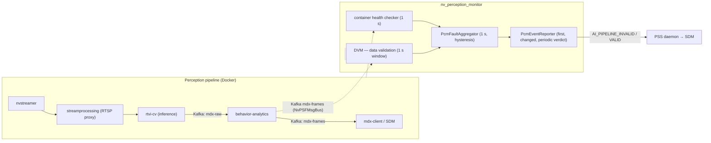
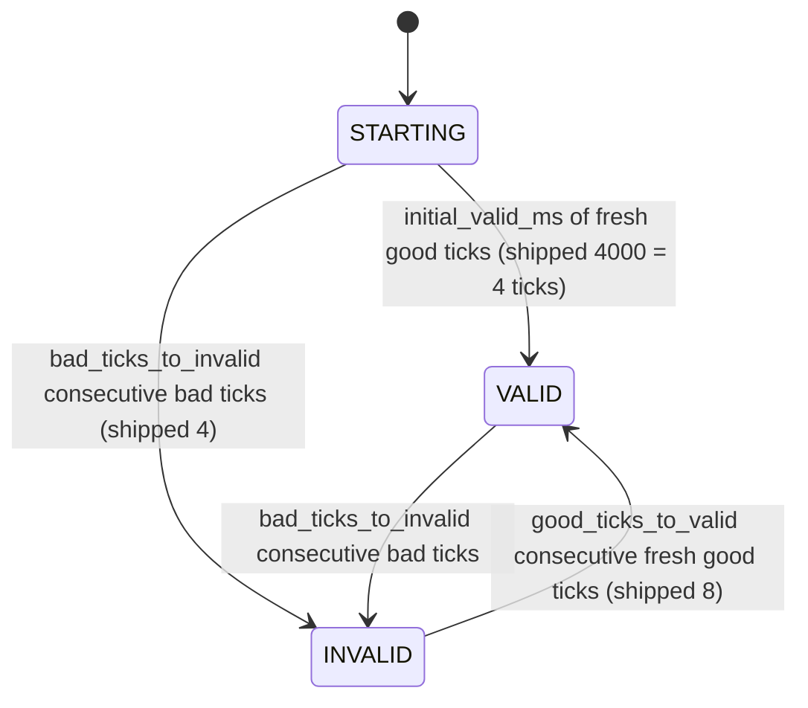

<!--
SPDX-FileCopyrightText: Copyright (c) 2026 NVIDIA CORPORATION & AFFILIATES. All rights reserved.
SPDX-License-Identifier: Apache-2.0
-->

# PCM — Perception Container Monitor

`nv_perception_monitor` — PSF safety client `CLIENT_PERCEPTION_MONITOR` (id 4).

## Overview

PCM judges whether the AI perception pipeline can be trusted and reports a single verdict —
**`AI_PIPELINE_VALID` / `AI_PIPELINE_INVALID`** — to the PSS daemon. The daemon forwards the verdict
into the safety decision path (broadcast to `CLIENT_MDX`, setting `SensorData.isTrustedSource`), so
PCM is a direct input to the SDM safe-state decision.

A container being "up" is not sufficient: the pipeline can be running yet emitting implausible
detections, feeding from an unknown sensor, or producing no frames. PCM detects these through **two
independent checks**, combines them in one aggregator, and emits a single debounced verdict.

**Faults versus setup problems.** PCM sends `AI_PIPELINE_INVALID` only for real container or
perception-data faults. A configuration or setup problem (empty container list, Docker or Kafka
unreachable, missing baseline) is printed in `pcm.log` and turns the affected check off; it never sends
`INVALID` by itself and never clears an existing one. See [What PCM reports](#what-pcm-reports).

> An earlier log-content scanner from the original design is not part of this build.

## Architecture



**Scope.** The container-health check health-checks only the containers named by an allow-list
(`monitor_container` entries, exact names) in `config/pcm_monitor.cfg`, inspecting each by name; a
listed container is judged once it has been seen on this host, and one that never appears is only
reported. The DVM validates every sensor it sees on `mdx-frames` against the learned per-sensor
baselines.

### Components

| File | Role |
|---|---|
| `perception_monitor.{h,cpp}` | `main()`, arg/mode parsing, PSS register + heartbeat, the 1 s health thread, thread lifecycle |
| `container_health_checker.{h,cpp}` | container health — Docker lifecycle/HEALTHCHECK state, `isLifecycleFault` |
| `data_validation_monitor.{h,cpp}` | data validation (DVM) — LEARN observe + baseline write, ACTIVE checks + 1 s window |
| `kafka_frame_source.{h,cpp}` | `mdx-frames` consumer (`NvPSFMsgBus`/`NvPSFMsgCodec`), decode → `DvmFrame` |
| `pcm_fault_aggregator.{h,cpp}` | count-based 1 s aggregator (`reportHealth`/`reportDvm`, freshness, hysteresis, first status) |
| `pcm_event_reporter.{h,cpp}` | PSS emit boundary (first status, changes, periodic repeat, failed-send retry) |
| `docker_client.{h,cpp}`, `json_extract.{h,cpp}` | Docker Engine API client over the socket + targeted JSON parse |
| `pcm_log.{h,cpp}` | SDM-style log lines `[time] [PCM][INFO\|WARNING\|ERR] ...` |

## Operating modes

Selected with `--mode LEARN|ACTIVE` (default `ACTIVE`).

- **LEARN** — DVM only; no PSS registration, no health checker, no aggregator. Observes
  `mdx-frames` for `--learn-duration` seconds (default 300), writes one complete camera-baseline bundle, and
  exits. The container-health check learns nothing. A LEARN stopped before its duration (signal or
  container stop) writes nothing, leaves existing baseline files unchanged, and exits with failure.
- **ACTIVE** — registers with PSS, starts the heartbeat, and runs the 1 s health thread, the DVM
  thread, and the aggregator. Reads the camera-baseline bundle written by LEARN.

LEARN and ACTIVE are separate invocations; LEARN does not transition to ACTIVE.

## Detection checks

### Container health

Each second the health thread inspects each **allow-listed** container **by name** via the Docker
Engine API (no full container enumeration) and collapses to one verdict:

- **Bad** if a container **seen in this run** is not running (including exit code 0), is paused,
  restarting or dead, has HEALTHCHECK `unhealthy`, or **has disappeared**. Docker's `Running=true`
  does not override the paused/restarting/dead flags.
- **Good** if every seen container is healthy and none is still starting.
- **Off** (no verdict) while the Docker socket is unreachable or the Docker API returns errors, or
  while no listed container has been seen. A container in HEALTHCHECK `starting` is also unjudged
  during `container_startup_grace_ms` (default 30000), measured from its first observation in that
  state. If none is bad and any is unjudged, the health check is off. Off is printed, never `INVALID`, and does not let an older
  good result count: a successful poll is needed to report again.

After the starting grace expires, a container still starting is **bad**. A previously faulted
container must become healthy: returning to `starting` does not clear its fault or grant another
grace. Docker API failures do not reset the starting deadline. The aggregator's normal bad-tick
debounce still applies after a health fault. An off health check does not prevent the independent
DVM check from judging data under the aggregation rules below.

A listed container that has never existed on this host is skipped, reported after `startup_grace_ms`,
and checked from the moment it appears. Each change (Docker reachable/unreachable, a container
faulting, recovering or appearing) is logged once.

The packaged list covers the direct, continuous producers in the warehouse replay deployment:
`vss-vios-nvstreamer`, `vss-vios-streamprocessing`, `vss-rtvi-cv`, `vss-behavior-analytics`, and
`kafka`. They carry video through inference (`mdx-raw`) and analytics (`mdx-frames`/`mdx-events`).
Use the actual source service instead of NvStreamer for other deployments. Registration, setup,
SDR/control services, Redis, PostgreSQL, dashboards, indexing and metrics are excluded. Their loss
can affect setup or recovery; DVM still detects loss of previously active camera data. Do not list
initialization jobs: every listed container is treated as a required continuous service.

### Data validation monitor (DVM)

Consumes `mdx-frames` (the feed `mdx-client` reads, on a distinct consumer group
`nv_perception_monitor_dvm`, `auto.offset.reset=latest`) via `NvPSFMsgBus`/`NvPSFMsgCodec`. Each 1 s
window counts bad/total frames separately for each camera. The DVM verdict is **bad** if any camera
reaches the configured bad-frame percentage or a camera that was sending frames falls below its
frame rate; **good** otherwise once a baseline camera has been seen; **off** before any baseline
camera has sent a frame.

PCM uses the same 8192-byte receive limit as MDX. The existing message-bus API returns a generic
failure when discarding an oversized message, so PCM retains its existing error backoff. Faster
recovery after an oversized-message backlog remains an open issue; MDX and the shared Kafka
library are outside the scope of this PCM change.

| Check | Status | Behavior |
|---|---|---|
| **Unknown sensor** | active | Frame bad if its `sensorId` is not in the learned whitelist, so its frames always reach the bad-frame percentage. Logged once per id (sanitized, at most 16 ids). |
| **Selected decision data** | active | Uses the stored ROI/proximity contract selected from the event mapping and SDM configs during LEARN. Checks ROI violation values and object references, proximity metadata and range, and IDs/coordinates needed by configured object pairs. A failed check makes the frame bad; the per-camera `bad_frames_percent` threshold and fault debounce apply. Class-frequency, bounding-box-area and confidence checks are not used. |
| **Observation freshness** | active with a timestamp baseline | A missing, unusable, too-old or excessively future timestamp makes the frame bad. Duplicate or reordered timestamps do not count as fresh progress. |
| **Frame rate** | active (basic) | Per 1 s window, a camera that was **already sending before the window began** is bad if its fresh-frame count `< kDvmMinFrameRateRatio × expected_fps × window`; this includes every camera stopping together when polling continues without an explicit source error. A baseline camera that never sent a frame is not judged; it is reported after `startup_grace_ms` and checked once it appears. The window holding a camera's first frame is skipped (partial). |
| **Kafka unavailable** | reported | Consumer creation/receive failures are logged and turn data checks off, unless received-data corruption is already pending. |
| **Undecodable received data** | active | Ten consecutive undecodable messages report bad data, subject to normal fault debounce. Silence or a later connection error cannot clear the fault evidence. Decoded frames must resume and pass validation before recovery. Isolated errors below this limit remain tolerated. |
| **Redundant-sensor consistency, uncertainty and model consistency** | not implemented | These checks do not contribute a verdict. |

LEARN records camera timing and the selected decision contract; ACTIVE compares received data
against that baseline. `bad_objects_percent` remains accepted for configuration compatibility but
does not control these checks. `kDvmMinFrameRateRatio` is a policy value, not safety-validated.

## Baseline files

LEARN writes **`pcm_baseline.cfg`**, containing the complete observed camera set. Each camera's
record stores its raw `known_sensor` identity, `expected_fps`, `max_frame_age_ms` and the selected
ROI/proximity decision contract. ACTIVE matches the raw sensor identity; learned class and
bounding-box-area ranges are no longer validation criteria.

### Baseline location and resolution

The baseline path is resolved with the same precedence in both modes. Its **directory** holds
the canonical `pcm_baseline.cfg` bundle:

1. `--baseline-config <file>` (explicit)
2. `PCM_BASELINE_CONFIG` environment variable
3. default `/opt/nvidia/psf/bin/pcm_baseline/pcm_baseline.cfg`

There is **no world-writable fallback**: the baseline is written to and read from either the explicit
`--baseline-config`/`PCM_BASELINE_CONFIG` path or the default `/opt/nvidia/psf/bin/pcm_baseline/` — both
operator controlled. Existing explicit baseline paths remain supported. Older launchers learned into
`/opt/nvidia/psf/bin/` (the old default); ACTIVE prints a warning if learned `pcm_*_baseline.cfg`
files are still there while another folder is in use, because they are ignored. Native LEARN requires
write access to that directory; the Docker launcher prepares the mounted directory for its service
user. LEARN stages and validates the complete bundle, then publishes it with an atomic rename.
Interruptions or failures before publication leave the previous bundle active. A symlink or other
non-regular file at the target name is refused. Both modes resolve the same location so LEARN and
ACTIVE stay in sync.

The package and image ship the loading-dock-3-cameras reference profiles from `default_baseline/`
as `pcm_<sensor>_baseline.cfg.default` in that directory. ACTIVE resolves the camera set as follows:

1. If `pcm_baseline.cfg` exists, use only that complete bundle. Do not merge legacy files or
   packaged defaults into it. An invalid bundle does not fall back to older profiles.
2. Only when no bundle exists, read legacy `pcm_<sensor>_baseline.cfg` files and packaged defaults.
   A readable learned file takes precedence over its matching `.cfg.default` file.

A readable but malformed legacy file is not silently replaced by its default. LEARN leaves legacy
files and packaged templates untouched; after successful publication they are excluded by the bundle.
Defaults describe the reference scene, not arbitrary deployments. **Run LEARN before ACTIVE on a
different camera set or SDM profile.** Using the reference profiles with other camera IDs produces
unknown-camera faults; PCM does not automatically disable validation on that mismatch. After successful
site-specific LEARN, ACTIVE uses only the newly learned camera set, even if reference files remain.
If data validation is enabled but no usable learned or default baseline is found, ACTIVE prints the
cause and runs with data validation off; the container-health check still runs, and if nothing is left
to check PCM sends no status. Container-health-only mode does not need a DVM baseline.
The launcher does not automatically run LEARN before ACTIVE; they remain separate invocations.

## Fault aggregation and emission

Each check reports one verdict (good, bad or off) ~once per report period to `PcmFaultAggregator`,
which evaluates on its own 1 s thread.
The verdict, report sequence and report time are updated together under the same lock, so the
evaluator cannot combine one report's verdict with another report's freshness. The reporter also
rejects an unjudged state; only the aggregator's first completed judgement enables emission.



Per tick:

- **Bad tick:** any check reports bad. A bad report keeps counting on later ticks until the check
  reports again or goes stuck.
- **Good tick:** every check that has a verdict reports good, and each sent a **new** report since the
  previous tick. A good check with no new report **pauses** the tick (counters unchanged).
- **Held tick:** otherwise (for example no check has a verdict); counters unchanged.
- An **off** check contributes nothing. A check that sends no new report for longer than
  `max_report_age_ms` is **stuck**: it is logged, contributes nothing, and blocks good ticks until it
  reports again. Being stuck never sends `INVALID` by itself.
- A check that goes off or stuck **while INVALID** must report good again before good ticks resume:
  losing sight of the pipeline does not prove the fault cleared.

`STARTING` sends no status. The first `VALID` or `INVALID` is always sent (so a restarted PCM
republishes its validated state and clears an `INVALID` left in PSS by a previous instance; the SDM
latch still needs operator release). Changes are sent immediately after judgement, and the current
verdict is repeated every `verdict_resend_ms` (default 5000) after its last successful send. A failed
send is retried on the next evaluator tick and does not reset the repeat deadline. Repeats do not
rejudge an unobserved pipeline or release an SDM latch. Before the first judgement nothing is sent,
including periodic repeats. Counts are one-second evaluator ticks, not
exact elapsed seconds: tick phase, monitor sampling and reporting affect the observed delay. The
emitted `SafetyEvent` carries the verdict in `ev.type`; no `severity` field is set (`psf3`
`SafetyEvent` has none).

## What PCM reports

| PCM sees | Result |
|---|---|
| A container seen in this run is stopped (any exit code), paused, restarting, dead, unhealthy or gone | bad → `INVALID` |
| Container HEALTHCHECK is `starting` | unjudged during `container_startup_grace_ms`, then bad; never clears an existing fault |
| A camera that was sending AI frames stops (alone or with all cameras) | bad → `INVALID` |
| Frames from a camera not in the baseline | bad → `INVALID` |
| `>= bad_objects_percent` bad objects in a frame / `>= bad_frames_percent` bad frames for a camera | bad → `INVALID` |
| Container list empty or with bad lines; listed container never seen | logged; bad lines skipped, the rest checked |
| Docker socket unreachable or Docker API errors | logged; container health off until Docker answers |
| Kafka consumer creation/receive error | logged; does not itself cause INVALID |
| Ten consecutive received messages cannot be decoded | bad → `INVALID` after normal debounce; remains bad until decoded frames resume |
| Baseline camera that never sent a frame | logged after `startup_grace_ms` |
| No baseline with data validation enabled | logged; data validation off |
| Check stuck longer than `max_report_age_ms` | logged; blocks `VALID` until it reports |
| Nothing left to check | logged; PCM stays registered and sends no status |
| Both checks disabled in `[monitors]` | refuses to start (configuration error) |
| `LEARN` stopped early | nothing written; exits with failure |
| `LEARN` observes sustained undecodable data | previous baselines retained; re-run LEARN with a healthy feed |

## Configuration — `config/pcm_monitor.cfg`

| Section | Purpose |
|---|---|
| `[monitors]` | `container_health` / `data_validation` (bool, default `true`) — which ACTIVE checks run |
| `[fault_aggregator]` | Required `bad_ticks_to_invalid` / `good_ticks_to_valid` — consecutive one-second evaluator counts (shipped `4` / `8`). Optional `max_report_age_ms` (`4000`), `initial_valid_ms` (`4000`) and `verdict_resend_ms` (`30000`) |
| `[data_validation]` | Required when DVM is enabled: `bad_objects_percent` / `bad_frames_percent` — inclusive percentage thresholds (shipped `25` / `25`). Optional `startup_grace_ms` (`10000`) |
| `[health_monitor]` | `monitor_container` lines — allow-list of exact container names health-checked (each inspected by name). Optional `container_startup_grace_ms` (`30000`) |

Packaged to `/opt/nvidia/psf/bin/pcm_monitor.cfg`; overridable via `PCM_MONITOR_CONFIG`. Read in
ACTIVE only (LEARN does not use it).

**`[fault_aggregator]`** requires both counts as positive integers (`1..2147483647`); zero,
negative, fractional, overflowing, unknown or duplicate timing settings are rejected. Missing or
unreadable config and missing timing keys also fail ACTIVE startup, before PSS registration. There
is no compiled timing fallback: existing operator configs must add this section when upgrading.

```ini
[fault_aggregator]
bad_ticks_to_invalid = 4
good_ticks_to_valid = 8
```

**Optional millisecond settings.** `max_report_age_ms`, `initial_valid_ms` and `verdict_resend_ms`
(in `[fault_aggregator]`), `startup_grace_ms` (in `[data_validation]`) and
`container_startup_grace_ms` (in `[health_monitor]`) accept positive whole milliseconds up to
`2147483647`. A missing line, an invalid value (zero,
negative, non-numeric, overflowing) or a repeated line prints a warning and uses the built-in value
(4000 / 4000 / 30000 / 10000 / 30000 respectively). Aggregation and DVM timing are logged at
startup; the container starting allowance is logged when that state is first observed.

```ini
[fault_aggregator]
# A check silent longer than this is stuck.
max_report_age_ms = 4000
# Fresh good results needed before the first VALID.
initial_valid_ms = 4000
# Repeat the current judged verdict after a successful send.
verdict_resend_ms = 30000

[data_validation]
# Unseen cameras/containers are reported after this.
startup_grace_ms = 10000

[health_monitor]
# Grace for an observed container's HEALTHCHECK starting state.
container_startup_grace_ms = 30000
```

Very small values are accepted but behave accordingly: for example `max_report_age_ms` below the ~1 s
report period treats normal reporting as stuck and blocks `VALID`.

The numeric bounds prevent representation errors; they are not approved safety-response limits.
Select counts within the deployment's response-time budget. Settings are read once at startup, not
hot-reloaded. After installing a build with this support, edit the host config and restart PCM (or
recreate the container if an editor replaced the bind-mounted file). No new image is needed for a
timing-only config change. The one-second health/DVM/evaluator cadence is unchanged.

**`[data_validation]`** requires both percentages as integers in `1..100` when DVM is enabled.
There are no compiled percentage defaults; missing, invalid, duplicate or unknown percentage
settings fail ACTIVE startup before PSS registration. LEARN does not require these settings.

```ini
[data_validation]
bad_objects_percent = 25
bad_frames_percent = 25
```

Both comparisons are inclusive: 1 bad object out of 4 makes a frame bad, and 1 bad frame out of
4 from a camera makes its window bad. At 30 frames/window, 7 bad frames stay below 25%; 8 reach it.
Healthy cameras cannot dilute another camera's bad-frame ratio. Counters reset every window.
Empty frames are not object-plausibility faults; a camera with no frames is handled by the
frame-rate rule (only for cameras already sending), not by dividing by zero. Low frame rate makes the
window bad independently of the percentage thresholds. All settings use the same mounted config and
restart procedure above.

**`[monitors]`** selects which checks run; both default on. A disabled check contributes nothing, so
the combined verdict is driven by the enabled check(s); disabling both refuses to start. For a
**remote** perception stack whose containers are not on this host's Docker, the listed containers are
never seen locally and are only reported; disable `container_health` there to avoid the warnings. The
DVM can still reach a remote broker via `--kafka-broker`.

**`[health_monitor]`**: a listed container is checked once it has been seen on this host; once seen,
stopping, pausing, restarting, becoming dead/unhealthy or disappearing is a fault. HEALTHCHECK
`starting` follows the separate grace described above. A container that never appears is reported
after `startup_grace_ms`. A bad line (missing `=`, unknown key, empty or invalid container name,
duplicate) is skipped with a warning and the valid lines are still used. With no valid entry the
container-health check is off for the run (logged).

## Build and run

Built as the CMake target `nv_perception_monitor` (option
`SAFETY_CORE_BUILD_PERCEPTION_MONITOR`, on by default; it needs the VSS MDX message bus and codec
adapters) and installed to `/opt/nvidia/psf/bin/`. The Kafka path requires `librdkafka.so.1` (a
transitive dependency of `libnvpsf_msgbus.so`) on the loader path.

PCM log lines use the SDM log format, `[YYYY-MM-DD HH:MM:SS.mmm] [PCM][INFO|WARNING|ERR] message`
(local time; INFO on stdout, WARNING/ERR on stderr; data-validation lines start with `DVM:`). Lines
printed by the Kafka and PSS client libraries keep their own format.

```bash
# LEARN (writes per-sensor baselines, then exits)
nv_perception_monitor --mode LEARN --learn-duration 300

# ACTIVE (requires the PSS daemon up; reads the baselines)
nv_perception_monitor --mode ACTIVE
```

`--baseline-config <file>` / `PCM_BASELINE_CONFIG` override the baseline location (see above).

### Launcher and Docker

`launch_psf.sh` requires independent `--saim-mode learn|active|skip` and
`--pcm-mode learn|active|skip` selections. Neither monitor's mode selects the other.
The control plane runs when either monitor is ACTIVE or both are skipped; other combinations
run only the selected learners.

When the control plane runs, `nvpss.conf` must match those selections:
`required_safety_monitor` is `1` for SAIM ACTIVE and `0` for SAIM LEARN or skip;
`required_perception_monitor` follows the same rule for PCM. A mismatch fails before services
start. The launcher never rewrites this policy. Learning-only jobs do not start PSS or require
these flags. Under Docker, mount an edited host file at `/opt/nvidia/psf/bin/nvpss.conf:ro`.

PSS still tracks the liveness of every registered monitor and numbered MDX client. Losing one
can latch all SDMs independently of PCM's data verdict. The launcher identifies its MDX client
as instance `1`, preserving PSS's required-source tracking.

In the container both AI monitors run **inside** the PSF container; on a Debian install
`launch_psf.sh` runs both natively. Both learners are supervised:
LEARN succeeds only when both enabled monitors succeed, and a failure stops the remaining learner.
ACTIVE supervises PCM alongside the other processes. PCM writes its own `/var/log/psf/pcm.log`.

The launcher accepts `--pcm-baseline-dir <dir>` (default `/opt/nvidia/psf/bin/pcm_baseline`) and
`--pcm-config <file>` (ACTIVE only, default packaged `pcm_monitor.cfg`). `--baseline-dir` remains
SAIM-specific. Under Docker, mount an explicit PCM config read-only, and the PCM baseline
directory writable for LEARN and read-only for ACTIVE. `--broker` forwards the same broker to PCM
and mdx-client.

These examples use the image built by the `safety_core_docker` target (`psf-desktop:latest`, or
`psf-tegra:latest` on aarch64). Host config files
and baseline directories must exist before using `-v`; an empty bind mount hides packaged defaults.
Use the package-installed reference directories for the reference scene, or generate site baselines
with LEARN. Prepare the sensor and SDM configs from their packaged `.sample` files.

```bash
# LEARN both monitors; writes baselines to the mounted host directories, then exits.
docker run --name nv-psf-learn --rm --gpus all \
    -e NVIDIA_DRIVER_CAPABILITIES=all --network=host \
    -v /var/log/psf:/var/log/psf \
    -v /opt/nvidia/psf/bin/sensor_config.conf:/opt/nvidia/psf/bin/sensor_config.conf:ro \
    -v /opt/nvidia/psf/bin/atl_sdm_zone1.conf:/opt/nvidia/psf/bin/atl_sdm_zone1.conf:ro \
    -v /opt/nvidia/psf/bin/saim_baseline:/opt/nvidia/psf/bin/saim_baseline \
    -v /opt/nvidia/psf/bin/pcm_baseline:/opt/nvidia/psf/bin/pcm_baseline \
    psf-desktop:latest --saim-mode learn --pcm-mode learn --learn-duration 300 \
    --app atl --sdm-config /opt/nvidia/psf/bin/atl_sdm_zone1.conf \
    --sensor-config /opt/nvidia/psf/bin/sensor_config.conf --broker <broker:9092>

# ACTIVE with single ATL and both monitors. SDM combination arguments are unchanged.
docker run --name nv-psf --gpus all \
    -e NVIDIA_DRIVER_CAPABILITIES=all --network=host \
    --group-add "$(getent group docker | cut -d: -f3)" \
    -v /var/run/docker.sock:/var/run/docker.sock \
    -v /var/log/psf:/var/log/psf \
    -v /opt/nvidia/psf/bin/sensor_config.conf:/opt/nvidia/psf/bin/sensor_config.conf:ro \
    -v /opt/nvidia/psf/bin/atl_sdm_zone1.conf:/opt/nvidia/psf/bin/atl_sdm_zone1.conf:ro \
    -v /opt/nvidia/psf/bin/pcm_monitor.cfg:/opt/nvidia/psf/bin/pcm_monitor.cfg:ro \
    -v /opt/nvidia/psf/bin/saim_baseline:/opt/nvidia/psf/bin/saim_baseline:ro \
    -v /opt/nvidia/psf/bin/pcm_baseline:/opt/nvidia/psf/bin/pcm_baseline:ro \
    -d psf-desktop:latest --saim-mode active --pcm-mode active --app atl \
    --sensor-config /opt/nvidia/psf/bin/sensor_config.conf \
    --sdm-config /opt/nvidia/psf/bin/atl_sdm_zone1.conf \
    --cmd_rx_ip <receiver-ip> --cmd_rx_port 12345 --broker <broker:9092>
```

To run SAIM without PCM, select `--pcm-mode skip`. For ACTIVE, also set
`required_perception_monitor = 0` in the mounted `nvpss.conf`. PCM's verdict generation, debounce
timing, SDM fault latches and operator-release rules are unchanged by these launch options.

## Key constants

| Constant | Value | Meaning |
|---|---|---|
| `kHealthIntervalSec` | 1 s | health poll + report cadence |
| `kEvalTickMs` | 1000 ms | aggregator combine + count tick |
| `kDvmWindowMs` | 1000 ms | DVM observation window (one verdict/window) |
| `kFramePollTimeoutMs` | 500 ms | max DVM wait per Kafka poll |
| `kDvmMinFrameRateRatio` | 0.5 | frame-rate fault threshold vs `expected_fps` (placeholder) |
| `kDefaultMaxReportAgeMs` / `kDefaultInitialValidMs` / `kDefaultStartupGraceMs` | 4000 / 4000 / 10000 ms | built-in values when the optional settings are missing or invalid |
| `kDefaultVerdictResendMs` / `kDefaultContainerStartupGraceMs` | 5000 / 30000 ms | optional verdict repeat / HEALTHCHECK starting grace defaults |
| `kRecvBufSize` | 8192 bytes | PCM receive bound, matching MDX |
| `kDefaultLearnDurationSec` | 300 s | LEARN default (`--learn-duration` to change) |
| `HB_INTERVAL_MS` | 5000 ms | PCM → PSS heartbeat |

## Not implemented / limitations

- Redundant-sensor consistency, uncertainty and per-frame model-consistency checks are not implemented.
- Frame-rate checks cover a per-sensor drop / silence vs the learned rate for cameras that have
  sent frames; a camera dead from start, sub-rate degradation, a stall on a never-learned sensor, and
  richer data-quality faults are not detected (a baseline without `expected_fps` gives no
  missing-frame coverage).
- `kDvmMinFrameRateRatio` is a policy value, not safety-validated.
- Docker/Kafka setup problems and never-seen containers/cameras are reported, not faulted, by
  design; container health on a remote stack therefore gives no coverage.
